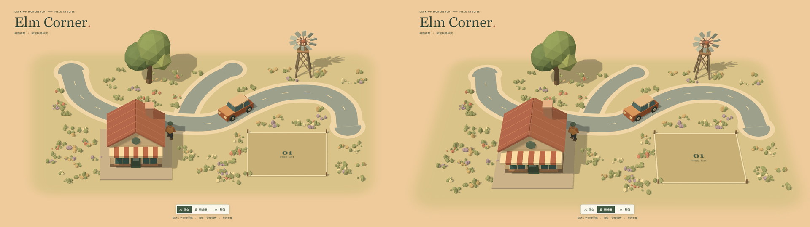

# P0-A · 榆荫街角镜头与风格试验

2026-11-19 · 视觉验收待定

**建议优先验收 B 弱透视。** 参考图的近边水平，远边较窄，小屋和田地靠前，树冠与灯塔形成后景。本轮把店铺和地块放在前排，用弯路连接中景，树和风车拉出后排轮廓。B 的地块远边自然收窄，A 保留平行边。42° 为试拍角度。样景的区域密度仍低于参考图。

| 视图 | A 正交 | B 弱透视 |
| --- | --- | --- |
| 1920 × 1080，全景 | [原图](screenshots/ortho-wide.png) | [原图](screenshots/perspective-wide.png) |
| 1920 × 1080，中心放大至 1.264× | [原图](screenshots/ortho-near.png) | [原图](screenshots/perspective-near.png) |
| 1366 × 768，复位全景 | [原图](screenshots/ortho-compact.png) | [原图](screenshots/perspective-compact.png) |

## 构图与尺度

世界 Y 向上，+X 向右，−Z 向远方。从目标点向相机看，水平位置位于 +Z 方向（偏航 0°），镜头向下俯视 42°，横滚 0°。两种投影共用目标 (0, 0, −1.6)、同一场景实例、光照和植被种子 1271。初始倍率 1，目标距离 64.085。右侧空地为 8 × 6.5 世界单位。

| 1920 × 1080 开场测量 | A 正交 | B 弱透视 |
| --- | ---: | ---: |
| 投影设置 | 垂直跨度 22.6 | 垂直 FOV 20° |
| 穿过目标且垂直视线的平面宽度 | 40.18 | 40.18 |
| 屏幕底边 / 顶边投到地面的宽度 | 40.18 / 40.18 | 33.60 / 49.96 |
| 空地四角投影的轴对齐包围框 | 382 × 208 px | 447 × 241 px |
| 空地中心像素，从左上起算 | (1361, 735) | (1392, 750) |

弱透视的初始距离由垂直跨度除以两倍半视场角正切得到。如此可以对齐目标深度处的尺度，保留两种投影在近景和远景的差异。窄窗优先保证横向覆盖至少 40 个单位（倍率 1 时）。1366 × 768 下，两套视图的地块和行人均在控制条上方。本次构图以聊天中提供的原图为参考。

## 交互与复现

- 鼠标或单指拖动沿地平面平移。WASD 和方向键沿屏幕对应的地面方向移动。目标 X 限制在 [−13, 13]，Z 限制在 [−11, 11]。
- 滚轮围绕光标缩放，双指以中点平移并缩放，倍率范围 0.72–2.6。触及平移边界时优先保持边界。所有操作锁定镜头朝向。
- 点击空地高亮并显示编号，点击其他地面清除选择。切换投影保留目标和倍率，复位恢复初始构图。URL 保存投影；重新打开时回到该投影的开场位置。
- 在仓库根目录运行 `npm ci`、`npm run dev`。打开终端所示本机地址，加上 `/?camera=ortho` 或 `/?camera=perspective`。

## 测试记录

Windows 桌面，Node 24.14.0，Chrome 157.0.8103.52，Playwright 驱动无头 Chromium 内核，ANGLE SwiftShader，DPR 1。截图在生产构建完成首次渲染后采集。静态场景仅在视图或选择变化时重绘。

| 检查 | 结果 |
| --- | --- |
| `npm run lint`、`npm run typecheck`、`npm run build` | 通过。Vite 提示主包超过 500 kB。 |
| `npm test`，生产预览 | 通过，1 个端到端用例遍历两套投影。打开 URL、切换和复位均符合预期。 |
| 拖动、键盘、滚轮、浏览器模拟双指操作 | 拖动时相机和目标位移相等，方向键改变目标，滚轮及双指改变倍率，四元数保持一致。 |
| 平移、放大、缩窄窗口后点选 | 两套投影都能选中地块并清除选择。 |
| 浏览器运行时 | 未捕获页面异常、控制台错误或失败请求。全景两套投影的渲染计数均为 149 次 draw call。 |
| 截图人工复核 | 六张原图中树、店铺、行人、旅行车、路口与地块均可见，控制条未遮挡地块。 |

复跑时可先执行 `npx playwright install chromium` 再运行 `npm test`。本机使用已安装的 Chrome，PowerShell 设置 `$env:BROWSER_CHANNEL='chrome'`。若系统配置了网络代理，将 localhost 和 127.0.0.1 加入 NO_PROXY 以允许本机生产预览探测。用例会重建上表中的截图和拼图。

本轮没有真机触屏或独立显卡性能测量。请分别验收横向铺开的固定构图、投影偏好，以及人物、树木和车辆的切面风格。

## 上次试拍

32° 试拍参数仍可通过 framing=frontal 查看。上一轮直路布局见[存档截图](screenshots/frontal-compact.png)。
